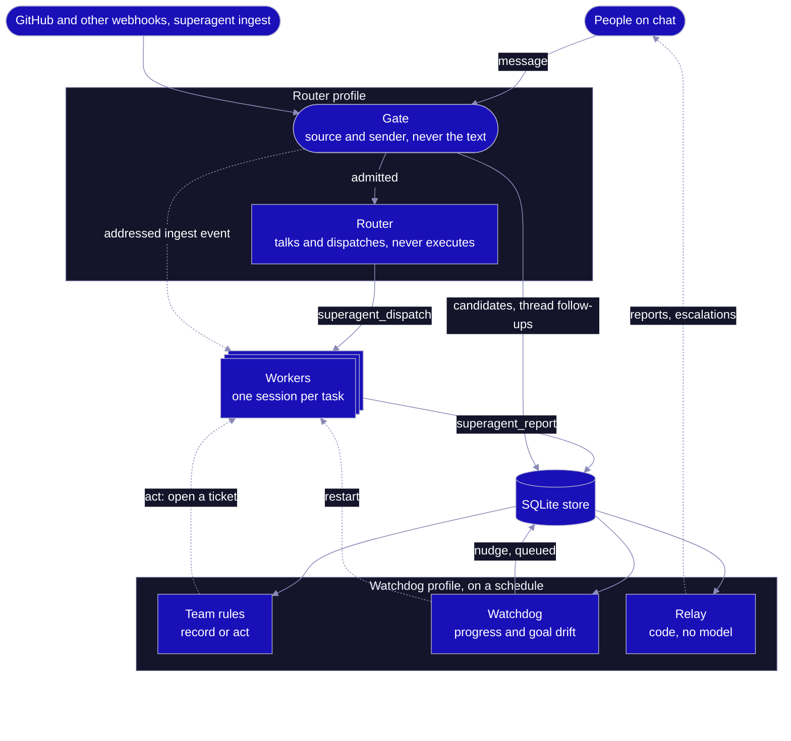
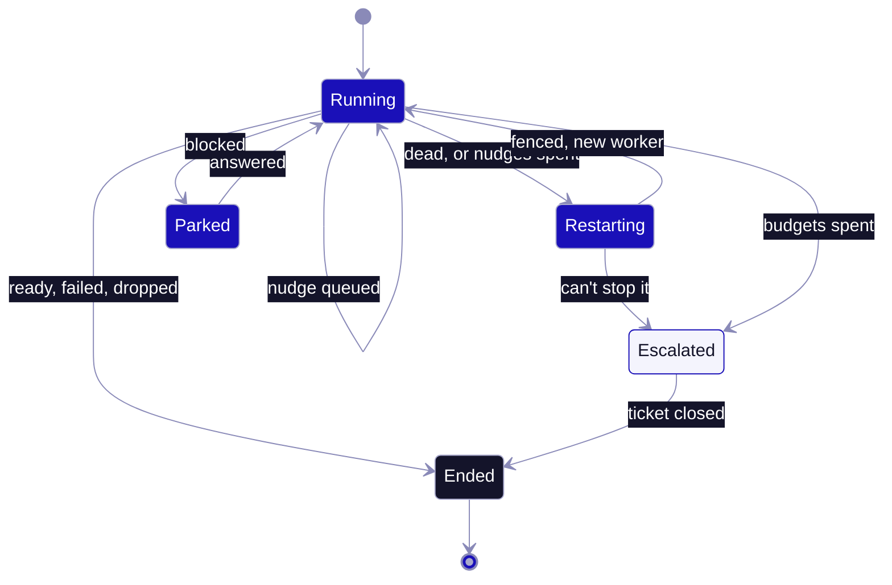
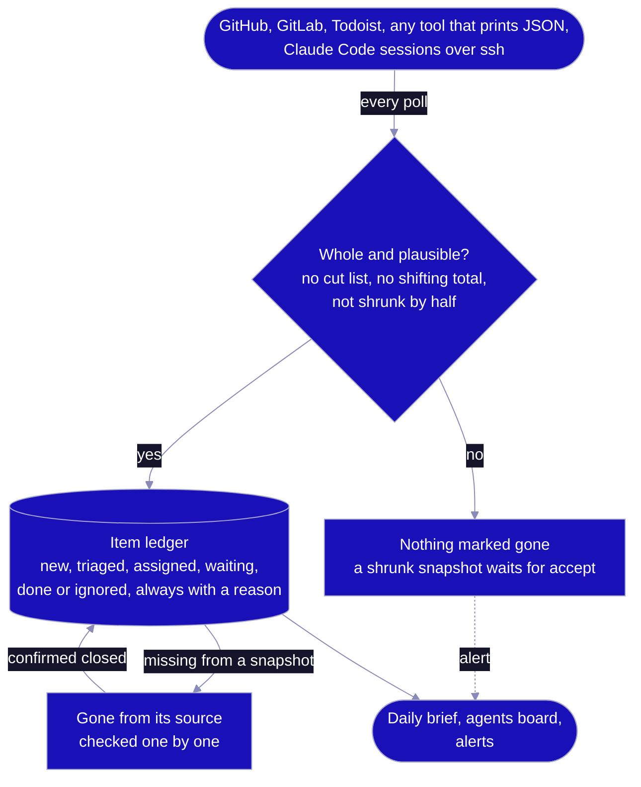

<div align="center">


<p>A <a href="https://github.com/NousResearch/hermes-agent">Hermes Agent</a> plugin for when you run more agents than you can watch.<br>
You talk to one router, and every task gets its own worker.<br>
A watchdog outside them restarts or escalates the stuck ones,<br>
and a ledger keeps every issue, task and Claude Code session until it's really closed.<br>
Based on DeepSeek's <a href="https://mp.weixin.qq.com/s/zoS7GlReWPhfCjENGxXCdg">Super-agent design</a>.</p>

<p>
<a href="https://github.com/AirKyzzZ/hermes-superagent/actions/workflows/ci.yml"></a>
<a href="LICENSE"></a>
<a href="pyproject.toml"></a>
<a href="plugin.yaml"></a>
<a href="tests"></a>
<a href="docs/hackathon.md"></a>
</p>

<p>
<a href="#quickstart">Quickstart</a> ·
<a href="#why">Why</a> ·
<a href="#architecture">Architecture</a> ·
<a href="#features">Features</a> ·
<a href="#install">Install</a> ·
<a href="#configuration">Configuration</a> ·
<a href="#comparison">Comparison</a> ·
<a href="#security-model">Security</a> ·
<a href="#roadmap">Roadmap</a> ·
<a href="#contributing">Contributing</a>
</p>

</div>


## Quickstart

Three commands and about ten seconds. No Hermes, model, network or credentials: the workers are scripted. You need Python 3.11+ on macOS or Linux.

```bash
git clone https://github.com/AirKyzzZ/hermes-superagent
cd hermes-superagent
python3 demo/run_demo.py
```

If your `python3` is older, as on a stock Mac, `uv run --no-project --python 3.12 demo/run_demo.py` fetches a newer one. To point the ledger at your own GitHub issues, still without Hermes, go to [Install](#install).

## Why

DeepSeek's article puts the limit at three to five active sessions: past that, a person's attention runs out before the models do. Here you never manage sessions.

- **Continuous:** you talk to one router on the channels you already use.
- **Efficient:** each task gets its own worker, so a new request never waits for an old one.
- **Proactive:** events pass a gate on who sent them, then rules your team writes in plain language. A daily digest shows what each rule in record mode would have started, so you switch it to `act` only once it's right.
- **Persistent:** state lives in SQLite, and a scheduled process outside the workers checks that the work is really moving.
- **Nothing dropped:** connectors read GitHub, GitLab, Todoist, any tool that prints JSON, and every Claude Code session on your machines into a ledger, and triage rules file what comes in by area. An item stays open until its source confirms it closed or you close it with a reason, and a daily brief shows each open one at least every few days.

A prompt or skill can only ask a model to stay in its lane, or to remember a task. Here the gate, the tool allowlist, fencing, the watchdog process and the ledger's completeness checks are code the model can't talk its way past or forget, which is why this has to be a plugin.

> [!WARNING]
> Early build. The router and worker path has never run with a live model. CI runs it on real Hermes v0.22.7 with a fake model: a gateway message passes the gate, the router dispatches, workers overlap, report, get guarded, fenced and stopped for real, and the watchdog relays the result. The ledger, its connectors and the agents board don't need a model, only `superagent briefs` does.

## Why not just...

- **...open more Claude Code tabs?** Past three to five sessions you become the scheduler, and a session stopped by a rate limit waits until you happen to look. The agents board puts every session from every machine on one list and posts one line when one needs you.
- **...write a prompt or a skill?** A skill can ask a model to stay in its lane and remember a task, it can't make it. The gate, the tool allowlist, fencing and the watchdog are code outside the model.
- **...rely on GitHub notifications and a to-do app?** They show what's new, not what quietly disappeared. The ledger keeps an item open until its source confirms it closed, and lists every open one in the daily brief at least every few days.
- **...run a cron job that sweeps your tools?** This started as a replacement for exactly that. A sweep that misses a page or gets a cut list drops work without a word. Here a cut list, a total that shifts mid-scan or a snapshot that shrinks by half is held back and alerted.
- **...use another orchestration plugin?** nerve, agora and diaktoros are further along and each solves a different problem, see the [comparison](#comparison).

## Architecture



On the gateway, the router's model only sees messages the gate let through, plus an allowed person's `/` commands that Hermes turns into a turn, such as skills. A webhook or `superagent ingest` event from an allowed sender skips that model: code opens the ticket, with the event text as the goal. In the documented setup workers have no messaging tools, so their reports go to the store and code relays them.

### One task

```mermaid
sequenceDiagram
    participant person as Person
    participant gate as Gate
    participant router as Router
    participant store as Store
    participant worker as Worker
    participant tick as Watchdog tick

    rect rgb(20, 20, 42)
        person->>gate: fix the login redirect loop
        gate->>store: record the admitted trigger
        gate->>router: pass the message on
        router->>store: superagent_dispatch(trigger, goal)
        router->>worker: start with a brief and a fence token

        loop until the task ends
            worker->>store: superagent_report(progress)
            tick->>store: check progress and goal drift
        end

        alt worker is blocked
            worker->>store: superagent_report(blocked, question)
            tick->>person: relay the question
            person->>gate: answer
            gate->>worker: in a thread, a new worker resumes with the answer
            Note over gate,store: outside a thread, the router's model<br/>calls superagent_forward
        else worker is done
            worker->>store: superagent_report(ready, summary)
            tick->>person: Done, in at most 100 words
        end
    end
%%{init: {"theme":"base","sequence":{"mirrorActors":false,"diagramMarginY":48},"themeVariables":{"primaryColor":"#1a10b8","primaryTextColor":"#ffffff","primaryBorderColor":"#a9a9cc","lineColor":"#8a8ab8","textColor":"#ffffff","actorBkg":"#1a10b8","actorBorder":"#a9a9cc","actorTextColor":"#ffffff","actorLineColor":"#8a8ab8","signalColor":"#a9a9cc","signalTextColor":"#ffffff","labelBoxBkgColor":"#0a0a9a","labelBoxBorderColor":"#a9a9cc","labelTextColor":"#ffffff","loopTextColor":"#ffffff","noteBkgColor":"#0a0a9a","noteBorderColor":"#a9a9cc","noteTextColor":"#ffffff"}}}%%
```



### Watchdog



Stuck and drifting lead to the same repairs, within a budget per ticket. Code decides stuck: a dead process, silence, identical reports or the same tool call over and over. A judge with no tools decides drift and can only answer `on_track` or `drifting`, so the most a fooled judge can do is spend the budget and escalate, which ends the ticket. A broken judge never triggers a repair.

A live worker gets a nudge first, and it waits for that worker's next report, so a silent worker gets restarted on the next tick instead. An escalation stops the worker if it can, then relay tells the person on a best-effort basis, and a reply starts new work.

### Ledger



A poll that can't prove it saw everything marks nothing as gone, and the source shows as failing in the brief and on the alerts channel. An item that disappears from a source is asked about by id, and only a closed answer closes it. Anything else stays open under "gone without a close" until someone decides. The brief lists every open item at least once every `stale_after`, and that's tested on the text that was actually delivered.

## Features

| Routing | Workers | Watchdog and safety |
| --- | --- | --- |
| **A router that can't execute**<br> A `pre_tool_call` allowlist blocks everything else, and Hermes fails closed if the hook errors. | **One worker per task**<br> Its own session, directory and environment allowlist. `send_message` and cron are blocked, and the documented toolsets add no other messaging tool, so it reports through `superagent_report`. A terminal can still reach whatever its sandbox allows. | **An outside watchdog**<br> A separate scheduled process. It can nudge, restart or escalate within a budget, and can't edit rules or widen a task. |
| **A gate blind to content**<br> Pure code over source, sender and bot lists. The message text can't open it. | **Thread pass-through**<br> A follow-up in a task's thread reaches its worker in its next report result, with no router model call. | **Fenced repairs**<br> Each worker has its own token. It's fenced before it's stopped, so a late report from an old worker is refused. |
| **Rules that start quiet**<br> Team rules begin in `record` mode and only log what they would have done, until you set `act`. | **Parked, not lost**<br> A blocked task waits for an answer, then a new worker resumes with it. | **Inert until you opt in**<br> With no role set, its hooks do nothing and it offers no tools. |

| Sources | Sessions | Every day |
| --- | --- | --- |
| **A ledger that keeps everything**<br> Items are never deleted. Closing or ignoring one takes a reason, and every change is kept with the content it saw. | **An agents board**<br> A small hook on each machine and a read-only probe over ssh put every Claude Code session on one board: working, waiting, stuck, rate-limited, gone. | **A daily brief**<br> Source problems, what waits on you, what vanished, what reopened, what's new, and every other open item at least every few days. A box that was down catches up. |
| **Sources that fail loudly**<br> GitHub and GitLab through your `gh` and `glab` logins, or any tool that prints JSON. A cut list, a total that shifts mid-scan or a snapshot that shrinks by half is held back, never read as done. | **One line when one needs you**<br> A session waiting for you, stuck, rate-limited or gone for two polls posts one line to its channel. Its text stays out unless you opt in, and it's redacted then. | **Alerts and an outbox that never gives up**<br> Messages retry with backoff and stay in order. Lasting errors and stuck ticks are alerted, and a heartbeat lets an outside check notice a dead timer. |
| **Briefs that cite their sources**<br> `superagent briefs <item>` writes what a worker starts from, and every line names the piece it came from: the issue, the owner's comments, related items, the repo's guide. | **Drafted, challenged, revised**<br> A second model call reads the draft like a skeptical senior engineer, and a third fixes what it found. | **A lint the model can't argue with**<br> A URL or command that only a stranger's comment or mail holds never reaches a brief marked ready, and untrusted text means the owner approves first. |
| **Triage by plain rules**<br> `[[triage]]` rules file new items into areas, each with its own channel, or set them aside with a reason the brief shows. An item no rule matches stays new and keeps showing up. | **A nudge, only if you ask**<br> With `relaunch = true`, a session stopped by an API error or a rate limit gets one `continue`, typed only after its pane, process and screen check out. | **Setup and doctor**<br> `setup` writes a starter config from the tools it finds, and `doctor` checks delivery, the timer and every connector, live, without recording anything. |

## Install

### Watch your sources and sessions

One profile is enough, with no role, so the plugin stays inert in chat:

```bash
hermes plugins install AirKyzzZ/hermes-superagent --enable
hermes superagent --home ~/superagent setup --alerts discord:ALERTS_CHANNEL_ID
hermes superagent --home ~/superagent doctor
```

No Hermes yet? The ledger runs from the clone with the same commands, and `brief` prints what's open instead of sending it. With `gh` logged in, this lists your open issues, pull requests and review requests:

```bash
python3 -m superagent --home ~/superagent setup
python3 -m superagent --home ~/superagent doctor
python3 -m superagent --home ~/superagent tick && python3 -m superagent --home ~/superagent brief
```

`setup` writes a starter `superagent.toml` from what the machine has: a GitHub sweep when `gh` is installed and the agents board when Claude Code is, sending through the same `hermes`. It never overwrites a config. `doctor` checks the config, delivery, the timer and alerts, runs each connector's poll once without recording anything, and exits non-zero when something fails. Then run `hermes superagent --home ~/superagent tick` every 2 minutes. [The shadow install guide](docs/dogfood-install.md) has a systemd timer, other machines and the Claude Code hook.

### Run it with Hermes

Needs Hermes 0.22.7 or newer on macOS or Linux. These steps haven't been run end to end yet, see the warning above.

<details>
<summary><b>Setup steps</b></summary>

<br>

Install and enable it in each profile. The install scanner reports one caution, the sanitizer regex in `framing.py`, and asks you to confirm:

```bash
for p in router worker watchdog; do
  hermes profile create "$p"
  hermes -p "$p" plugins install AirKyzzZ/hermes-superagent --enable
done
```

Write `superagent.toml` in a directory the router and watchdog share:

```toml
[sources.discord]
policy = "explicit_only"
allow = ["YOUR_DISCORD_USER_ID"]

[worker]
argv = ["hermes", "-p", "worker", "chat", "-Q", "--query-file", "{brief}", "-t", "terminal,file,superagent"]

[outbound]
argv = ["hermes", "-p", "router", "send", "--to", "{channel}", "{text}"]

[[semantic]]
name = "silent-fix"
text = "Reproduce reported bugs quietly, speak up only with a confirmed fix."
mode = "record"
```

Give each profile its role in its `config.yaml`:

```yaml
plugins:
  entries:
    hermes-superagent:
      settings:
        role: router           # worker or watchdog in the others
        home: /path/to/shared/dir
```

Give the worker a sandbox in its own `config.yaml`:

```yaml
terminal:
  backend: docker
```

Remove `terminal` and `file` from the router with `hermes -p router tools`, keep gateway credentials out of the worker profile, restart the gateway so it picks up the plugin's toolset, and schedule the watchdog:

```bash
*/5 * * * * hermes -p watchdog superagent tick
```

Every message names its task, as in `Done [fix the login redirect · tk-1a2b]: …`, so replies can't get mixed up. To stop a task, tell the router, or run `hermes -p watchdog superagent cancel <ticket>`. Questions, results, failures and escalations reach people on the next tick. Progress stays in the store. A worker is whichever session runs in its own worker directory, so the worker profile refuses any other session and isn't for general chat.

Hermes defers plugin tools behind `tool_call` by default, and that works. Set `tools.tool_search.enabled: off` in a profile to hand its model the tools directly.

To take work from GitHub, add a route to Hermes's webhook platform in the default profile's `config.yaml`, with the secret you set on the GitHub webhook:

```yaml
platforms:
  webhook:
    enabled: true
    extra:
      routes:
        github:
          secret: "YOUR_GITHUB_WEBHOOK_SECRET"
          events: ["issue_comment"]
          filters:
            - field: "action"
              equals: "created"
          prompt: "Handle this comment on {repository.full_name}#{issue.number}: {comment.body}"
          profile: router
```

Then say who may start work from it in `superagent.toml`:

```toml
[sources."webhook:github"]
policy = "explicit_only"
allow = ["your-github-login"]
notify = "discord:YOUR_CHANNEL_ID"
```

The rendered prompt becomes the goal, the comment's author is checked against `allow`, and the issue becomes the task's thread, so later comments from allowed people reach the running worker. Results go to `notify`. Keep a real secret on the route: Hermes checks GitHub's signature with it, and without one anyone who can reach the route can claim to be any author.

</details>

## Configuration

`superagent.toml` lives in the shared directory, and edits to its rules apply without a restart. Unknown keys are refused, and if an edit breaks the file the plugin keeps running on the last good copy while every tick fails with the error until it's fixed. Hermes gives hooks no mention flag, so chat messages always count as addressed, and team rules only see listed bots and `ingest` events for now.

| Key | Default | What it does |
| --- | --- | --- |
| `[sources.<name>] policy` | required | `explicit_only`, `candidate` or `ignore` |
| `[sources.<name>] allow` | `[]` | People who may address the agent |
| `[sources.<name>] bots` | `[]` | Bots whose events can become candidates on a `candidate` source |
| `[sources.<name>] pass_strangers` | `false` | Lets strangers' thread messages reach a worker, framed and with no authority |
| `[sources.<name>] notify` | none | Channel that gets this source's results and escalations instead of the event's own, such as `discord:123` |
| `[sources."webhook:<route>"] via_router` | `false` | Lets the router's model read this webhook's admitted events instead of starting work directly. Authors still go through `allow` |
| `[[semantic]] name`, `text` | required | A team rule, written in plain language |
| `[[semantic]] mode` | `record` | `record` only logs, `act` opens a ticket |
| `[worker] argv` | required | Command for one worker, must reference `{brief}` |
| `[worker] allow_same_user` | `false` | Allows host tools in a worker with no sandbox |
| `[outbound] argv` | none | Delivery command using `{channel}` and `{text}`. Without it nothing is sent, and messages are still marked sent. A failed send fails every tick until it gets through. Retries back off up to 30 minutes and never give up, and `superagent outbox` lists what's waiting or drops a message for good. Messages over 1900 characters go out in numbered parts |
| `[digest] channel` | none | Where `superagent digest --send` and the daily digest blueprint deliver |
| `[channels] alerts` | none | Where alerts go. An alert is sent when a tick error has lasted `alert_after_seconds`, and "Resolved" follows once it has stayed clear as long. A tick stopped at its deadline, or one stuck holding the lock, is alerted at once. Alerts raised with no channel set wait for one |
| `[tick] deadline_seconds` | `600` | A CLI tick running longer is stopped. A tick that finds the lock held longer than this fails loudly instead of skipping |
| `[tick] alert_after_seconds` | `300` | How long an error has to last before it's alerted |
| `[heartbeat] argv` | none | Runs after every tick with no errors, such as a ping to an external uptime check, so a dead timer gets noticed from outside |
| `[channels] brief`, `[brief] hour`, `timezone` | none, `8`, `UTC` | The daily brief goes to `brief` once a day, from `hour` until the next day's `hour`, so a box that was down catches up. It lists source problems, what waits on you, what vanished from a source, what reopened, what's new since the last brief, what got ignored and why, and the day's readings. Every other open item shows at least once every `stale_after`, unless it's snoozed or its worker is running. "Since the last brief" only moves once every part of that brief has been delivered. `superagent brief` prints it now, and `--send` sends it |
| `[brief] stale_after` | `3d` | How long a triaged item can go unchanged before the brief lists it again |
| `[[triage]] match`, `area`, `ignore`, `name` | none | Rules for new items, the first match wins. `match` maps item fields (`connector`, `title`, `url`, `id`, `due`, `excerpt`) or meta keys such as `repo`, `labels` or `from` to a glob or a list of globs, ignoring case, where only `*` and `?` are wildcards. `labels`, `matched` and `tags` match on any one of their comma-separated parts, and an empty field never matches. `area` files the item there as triaged, and `ignore` sets it aside with that reason, which the next brief lists. An item no rule matches stays new and shows in every brief until someone decides. Rules also file new items already in the ledger, and never touch one someone moved |
| `[areas.<name>] channel` | none | Where one "New in <area>" message per tick lists what rules filed there, up to 20 items. Once any area is listed, rules can only name listed areas |
| `[channels] briefs`, `[briefs] notes`, `repos`, `daily_limit` | none, none, none, `20` | `superagent briefs <item>` writes the brief a worker would start from. Code builds a pack of numbered pieces, each marked trusted or not: the item, its issue text and comments (only the owner's own are trusted), related ledger items, its history, `notes`, and where `repos` says the code lives (keys are `owner/repo` for GitHub and `gitlab:group/project` for GitLab). The model drafts, a second call challenges it as a skeptical senior engineer, and a third revises. Code then checks that every line cites a real piece, quotes match their piece, there's an acceptance criterion, nothing looks like a secret, and every address, host, IP, account, shell command and multi-word code span appears in trusted text, after undoing lookalike characters. The first line says READY, NEEDS APPROVAL when any piece is untrusted, or NOT READY with the lint's findings at the end. A quote in the owner's own comment stays untrusted, and so does anything posted through an app. Briefs are cached until the pack or the writer changes, `daily_limit` caps new ones with failed attempts included, and `--send` posts it to `briefs` |
| `[connectors.<name>] type` | required | `command`, `github`, `gitlab`, `todoist`, `gmail`, `gcal`, `whatsapp`, `codexbar` or `agents`. A connector polls one tool into the item ledger |
| `[connectors.<name>] every` | `5m` | How often it polls |
| `[connectors.<name>] track` | `true` | `false` keeps its items, such as readings or events, without anyone owning them |
| `[connectors.<name>] quiet_after` | off, required for delta sources | Warns when the source has had nothing new for this long |
| `command`: `argv`, `fields`, `items` | required | Runs `argv` and reads its JSON. `items` is the dotted path to the list. `fields` maps `id`, `title`, `url`, `due`, `status`, `excerpt` and any extra meta key to a dotted path or a `{path}` template. A bad item fails the run but the good ones are still recorded, and a mapped path that no item has fails it too |
| `command`: `total`, `limit` | none | Catch a cut list: `total` is the path to the count the tool reports, which must match, and a run that returns exactly `limit` items fails |
| `command`: `complete`, `confirm_argv` | `true`, none | A complete source returns everything open each time, so items it stops returning are marked gone. A snapshot that shrinks by half or more is held back until `superagent ledger accept <name>`. `confirm_argv` with `{id}` checks one vanished item's `status`. An id that starts with a symbol or holds anything outside letters, digits and `._:/#@+=-` is never passed to it |
| `command`: `env`, `timeout`, `closed` | none, `60`, `closed`, `done`, `completed`, `true`, `merged` | Variables passed through to the command, its timeout (the whole process group is stopped), and the `status` values that mean closed |
| `command`: `complete = false`, `overlap`, `backfill` | `true`, `10m`, `14d` | A delta source gets `{since}` (UTC, `2026-11-05T22:00:00Z`), `{since_epoch}` or `{since_date}` (`2026/11/05`) in its `argv`. It starts `backfill` ago and each window reaches `overlap` back into the previous one |
| `[connectors.<name>] announce_new` | `false` | Posts one message per poll to the connector's `channel`, which it requires, listing the items that source showed for the first time, up to 20. A source's very first poll stays quiet |
| `[connectors.<name>] trusted` | `false` | Marks a source as the owner's own words, such as a personal task list, so briefs treat its items as trusted. Refused on `github` and `agents`, where trust comes from who wrote each comment |
| `[connectors.<name>] owned`, `channel`, `notify`, `notify_detail` | `false`, none, none, `false` (agents: `true`, none, `waiting`, `stuck`, `limited`, `gone`, `false`) | Owned items start as the owner's instead of new. When an item's `state` has been one in `notify` for two polls, one line goes to `channel`. It names the item and its state, and adds its redacted text only with `notify_detail` |
| `agents`: `host`, `stall_after`, `python`, `timeout` | this machine, `20m`, `python3`, `30` | Reads every Claude Code session on a host from the hook's logs, over ssh when `host` is set, and turns each into an item with its state: working, waiting, stuck, limited, background, idle, gone or ended. `superagent agents` prints the board. Setup is in [the shadow install guide](docs/dogfood-install.md) |
| `agents`: `relaunch`, `nudge`, `retry_after`, `tmux`, `cmux` | `false`, `continue`, `10m`, `tmux`, `cmux` | Off by default, because it types into your terminals. When on, a session that stopped on an API error gets one `nudge` after `retry_after`, and one stopped by a rate limit gets it only once Claude Code says its own auto-resume went stale. Before typing, a script on the host checks that the session hasn't moved, that its `claude` process is alive and in the foreground of that tmux pane or cmux surface, that no other live session shares the pane, that the pane isn't scrolled back, synchronized, dead or ignoring input, and that the last line between two rules on screen is the empty prompt, with no dialog, vim mode, interruption or work in progress. In tmux the pane state is checked again inside the same server command that types, and in cmux the process must be in the foreground of that surface. Each session gets one nudge, and an attempt that times out counts. Every attempt is in `ledger show`, and anything held goes to the connector's `channel` as needing you. A session whose process died is never restarted for you: its line carries the `claude --resume` command |
| `github`: `queries`, `gh`, `timeout`, `env` | assigned, review requested and mentioned, `gh`, `120`, none | Searches GitHub through `gh api` with your existing `gh` login. Each query must include `is:open`. Every page is read in creation order, the total must hold across pages and match the distinct items returned, and results that GitHub hides behind SSO fail the query. A failing query still lets the others' items in, but marks nothing gone. `timeout` covers a whole poll. Issues that leave every query are checked one by one, and only a closed one is closed |
| `gitlab`: `queries`, `glab`, `hostname`, `timeout`, `env` | assigned issues, assigned merge requests, review requests and pending todos, `glab`, none, `120`, none | Reads GitLab through `glab api` with your existing `glab` login, run from `/` so a checkout's remote can't switch the host. Each query reads `issues`, `merge_requests` or `todos` and must ask for exactly `state=opened` (todos: `state=pending`), and `{me}` stands for your username. Every page is read, and the total GitLab reports must hold across pages and match the distinct items returned, except for todos GitLab hides from the list after counting them. Each todo is its own item, closed once GitLab lists it as done, and an assignment or review todo is skipped only when this poll's issue or merge request queries returned its target. Issues and merge requests that leave every query are checked one by one, only a closed or merged one is closed, and one that moved to another project is reported |
| `todoist`: `td`, `timeout`, `env` | `td`, `120`, none | Reads every open task in every project, subtasks included, with `td task list --all --json --full` through your existing [`td`](https://github.com/Doist/todoist-cli) login, and project names with `td project list --all --json`. A list `td` cuts before its last page fails the poll. Each task keeps its project, labels, priority, due date and deadline, and who added it, and a recurring task keeps its rule, such as `every day`, so ticking off one occurrence changes nothing. A failed project list records nothing that poll. A task that leaves the list is looked up with `td task view`, and only a completed one is closed. `TODOIST_API_TOKEN` is passed through, so a token works where `td auth login` can't run |
| `gmail`: `account`, `query`, `gog`, `timeout`, `env` | required, `in:inbox`, `gog`, `180`, none | One block per mailbox. Reads every thread `query` matches through [`gog`](https://github.com/openclaw/gogcli), always with `--readonly` and `--all` pages, so a page that fails fails the poll, and the count must match the distinct threads. `query` must include `in:inbox`. Each thread keeps its sender, labels and message count, and reading a mail changes nothing. A thread that leaves the inbox is looked up, and only one with no `INBOX` label left, archived or trashed, is closed. Category filters belong in triage rules, so what they set aside is listed with a reason. `gog` fetches every thread's details each poll, so an inbox of a few thousand threads can outrun `timeout`; a narrower query such as `in:inbox newer_than:90d` keeps it in time, but a thread that leaves the query while still in the inbox then stays open under "gone without a close" until you close it |
| `gcal`: `account`, `calendars`, `days`, `gog`, `timeout`, `env` | required, the ones shown in Google Calendar, `3`, `gog`, `120`, none | One block per account. Informational, so `track` is off, and it can't be `trusted` because anyone can send an invite. Reads `days` days from today through [`gog`](https://github.com/openclaw/gogcli), always with `--readonly` and every page, one calendar per call so one that fails fails the poll. `calendars` takes ids or `primary`. Times are in the primary calendar's timezone. Titles carry the date, such as `Mon 09 Nov 14:00 Dentist` or `ongoing until Thu 12 Nov Conference`, and a `days_away` in the meta that changes daily lists an event in each brief until it's over. Events you declined and working locations are left out, a meeting on two calendars shows once, and an event leaving the window closes nothing |
| `codexbar`: `providers`, `codexbar`, `timeout`, `env` | the ones enabled in CodexBar, `codexbar`, `120`, none | One reading per provider from [`codexbar`](https://github.com/steipete/CodexBar) `usage --format json`, titled with its quota, such as `claude: Weekly 21%`, and keeping each window's reset time and any cost in its meta. Informational, so `track` is off. A provider that reports an error fails the poll and the others still record, so name only the working ones in `providers` if one stays broken. `all` and `both` are refused because most providers aren't set up. `codexbar` can be a list, such as `["ssh", "mac", "/opt/homebrew/bin/codexbar"]`, when it lives on another machine. Use `every = "1h"`, since every change is a ledger entry |
| `whatsapp`: `chats`, `sync`, `sync_max_age`, `activity_max_age`, `wacli`, `timeout`, `env` | required, `follow`, `30m`, `6h`, `wacli`, `120`, none | Watches the chats listed by JID through [`wacli`](https://github.com/openclaw/wacli), always `--read-only`. A chat is an item while the last thing said in it isn't yours, and it closes once you reply. Your reactions, calls, poll votes and empty rows never count as a reply, their missed call counts as reaching out, and reading changes nothing. Every poll first asks `wacli doctor`: a store that isn't linked, or whose sync isn't running or has heard nothing for `activity_max_age` (`sync = "follow"`), or hasn't run within `sync_max_age` (`sync = "once"`), fails the poll. In a group chat anyone's message counts, so list groups only when that's wanted |
| `[watchdog] stall_after_seconds` | `900` | Silence that counts as stuck |
| `[watchdog] repeat_limit` | `3` | Identical reports in a row that count as stuck |
| `[watchdog] repeated_call_limit` | `5` | Identical tool calls and results in a row that count as stuck |
| `[watchdog] nudge_budget` | `1` | Nudges per ticket, reset when a person's answer resumes a parked ticket |
| `[watchdog] restart_budget` | `1` | Restarts per ticket, reset when a person's answer resumes a parked ticket |
| `[watchdog] orphan_after_seconds` | `30` | How long an open ticket can go without a worker before a repair |
| `[watchdog] reap_grace_seconds` | `30` | How long a finished worker can linger before it's stopped |

### Plugin settings and surface

<details>
<summary><b>Settings, tools and hooks</b></summary>

<br>

Settings go under `plugins.entries.hermes-superagent.settings` in each profile's `config.yaml`.

| Setting | Values |
| --- | --- |
| `role` | `router`, `worker`, `watchdog` or empty. Empty keeps the plugin inert |
| `home` | Directory shared by all three profiles, holding `superagent.toml` and the database |

| Tool or hook | Used for |
| --- | --- |
| `superagent_dispatch` | Router opens a ticket from an admitted trigger |
| `superagent_forward` | Router passes a follow-up to a running or parked ticket, resuming it |
| `superagent_cancel` | Router stops a ticket when the person who asked says so, and tells them |
| `superagent_status` | Router lists live tickets |
| `superagent_report` | Worker reports progress, blocked, ready, failed or dropped |
| `superagent_tick` | Watchdog assesses candidates, checks workers and relays |
| `superagent_digest` | Watchdog summarises recent work, waiting questions and what record-mode rules would have started |
| `pre_gateway_dispatch` | Runs the gate before Hermes handles a message, fails closed |
| `pre_llm_call` | Hands the router's model the admitted trigger ids |
| `pre_tool_call` | Enforces each role's tool policy |
| `post_tool_call` | Records worker activity for the watchdog |

`hermes superagent setup` writes a starter config and `doctor` checks a running one. `hermes superagent briefs <item>` writes a worker brief for one ledger item, and `briefs --compare past.json --out sheet.md --key key.md` sets new briefs beside the ones that ran for a blind comparison, see the [dogfood design](docs/dogfood-design.md#briefs). `hermes superagent ledger list`, `show`, `close`, `ignore` and `snooze` work on the item ledger, which keeps every item a source shows until someone closes it with a reason. Connectors fill it, see `[connectors]` above and the [dogfood design](docs/dogfood-design.md).

</details>

## Comparison

These are three of the closest plugins in the Hermes catalog. Each solves a different problem, and all three are further along.

| | hermes-superagent | [nerve](https://github.com/keeltrace/hermes-nerve) | [agora](https://github.com/yzy806806/agora) | [diaktoros](https://github.com/coe0718/diaktoros) |
| --- | --- | --- | --- | --- |
| **Version** | 0.1.0, not in the catalog | 0.4.15 | 2.0.13 | 0.5.0 |
| **Built for** | One agent in front of any work | Supervising agent turns and Kanban work: evidence, token spend, context | A role-based dev team that debates, votes and builds | Unattended pull request review and fixes, plus issue triage and CI repair |
| **Who you talk to** | A router that can't execute | Your usual Hermes agent | Your usual Hermes agent, with a leader chairing the team | Nobody, GitHub events drive it |
| **Unit of work** | One worker session per ticket | A Kanban card, on a local or SSH worker | A Kanban task for a role | A pull request |
| **What starts work** | Chat and ingested events, through a sender gate and team rules | Kanban cards | A project you start, then leader heartbeat and discussions | GitHub events |
| **Progress check** | Separate scheduled process: liveness, silence, repeats, goal drift | Hooks in a local worker, a controller-side bridge for SSH workers: locked definition of done, evidence, token checkpoints | Leader wakes on a cron to assess and unblock | Scheduled watchdog reports stalls, drains queued work and repairs routes, review rounds are capped |
| **When stuck** | Nudge, restart, escalate | Continue, watch, replan, block | Leader unblocks or raises a discussion | Reports it, disputes go to an adjudicator |
| **Requires** | Hermes 0.22.7+, macOS or Linux, a running gateway, a scheduler, a sandbox for worker tools | Hermes 0.21+, an API key for the default hosted backend | Hermes 0.20+, a running gateway | Hermes 0.21.5+, Linux, bubblewrap, three GitHub accounts, an HTTPS-reachable gateway |

Use nerve to gate Kanban completion on verified evidence, agora for a team that argues before it builds, and diaktoros for PR review. This one aims at a single agent in front of everything, and it's the least mature of the four. What we didn't find in these three is the combination: a resident router barred from executing in code, a trigger gate that ignores message text, and a tool-less judge checking each worker against its original goal from a separate scheduled process.

<sub>Based on each project's README and catalog entry at its pinned catalog commit and, for nerve's SSH path, its code, checked 2026-11-05.</sub>

## Security model

Event content is attacker-controlled, so who can start or steer work is enforced in code. Framing is a second layer that depends on the model, and an `act` rule lets a model reading event text open a ticket.

> [!CAUTION]
> The boundary is the sandbox. A worker on a local terminal backend runs as your OS user and could rewrite the router's config, so the plugin refuses it `terminal`, file and code tools unless its profile uses a sandboxed backend such as docker or you set `allow_same_user`. Agents outside Hermes that use the report command get no such guard. Hermes runs every profile's turns in one gateway process by default, so profiles scope config and credentials, not the OS process.

| Threat | Control |
| --- | --- |
| Prompt injection through a trigger | The gate never reads message text. Dispatch only accepts a trigger the gate admitted, offered within the hour, still allowed and unused |
| Router tricked into executing | `pre_tool_call` allowlist, plus toolsets you remove from the profile |
| Stranger steering a worker | Bots never reach workers. Strangers don't either unless a source opts in, and a stranger can't resume a parked ticket |
| Forged or late reports | Per-assignment token, hashed at rest, kept in a private file in the worker's directory. A session anywhere else gets no tools, and a worker is fenced before it's stopped |
| A report exfiltrating files | Relay is code. `MEDIA:` tags are neutralised and text is capped at 100 words |
| Watchdog fooled | The judge has no tools and returns one of two values, so the most it can do is spend the repair budget and escalate |

If the gate itself fails, the message is dropped and logged, so a person gets silence rather than a bypass. An allowed person's `/` commands skip the gate and go straight to Hermes unrecorded, even on an `ignore` source. They can reach the model as skills but can't start work, because dispatch needs a recorded trigger. The full threat model, with residual risks and known limits, is in [DESIGN.md](DESIGN.md#threat-model).

### What it does on your machine

- **Runs commands you configure:** one worker process per task from `[worker] argv`, the delivery command from `[outbound] argv`, and each connector's `argv` on its schedule during ticks, with only the environment variables you list. Workers keep running after the turn that started them.
- **Stops processes:** the watchdog signals its own workers' client process groups, which cancels their turns, and checks each start time first so a reused PID isn't hit.
- **Types into a terminal only if you turn it on:** with `relaunch = true`, an agents connector types its `nudge` (letters, digits and basic punctuation only) into a Claude Code session stopped by an API error or a rate limit, once per session, after the checks above.
- **Reads your sessions:** an `agents` connector runs a read-only probe script through the `host` command you configure, usually `ssh`, which reads the hook's logs and the process list. The hook is printed by `superagent agents --hook-script` and you install it yourself. It appends one redacted line per Claude Code event under `~/.superagent/sessions`, never blocks a session and keeps only an allowlist of pane variables from the environment.
- **Spends model tokens:** ticks call the watchdog profile's model through `ctx.llm` when there's a new report to judge or a candidate event to assess, and `superagent briefs` makes three calls per new brief, within `daily_limit`. Router and workers use their own profiles' models as usual.
- **Writes files:** `superagent.db` and per-worker directories under `home`, each with a brief and a private identity file, and it reads `superagent.toml` from there.
- **Leaves approvals to Hermes:** workers start non-interactively from an environment allowlist, so they inherit no YOLO or approval-bypass setting, and Hermes's approval rules still apply to them.
- **Doesn't:** make network calls of its own, send telemetry, or hold credentials. The scripts in `assets/art` that fetched the source image are build tools the plugin never runs.

## Roadmap

- [x] Router, one worker per ticket, gate, record-only rules, thread pass-through
- [x] External watchdog with nudge, restart and escalate
- [x] Guard hooks, runnable demo, CI against real Hermes discovery
- [x] Workers proven end to end on real Hermes with a fake model
- [x] Cancel on request, and a task label on every message
- [x] A daily digest, including what record-mode rules would have done
- [x] The router's chat path, from gateway message to relay, proven the same way
- [ ] First live run with a model and gateway
- [x] GitHub and other webhook sources
- [x] Item ledger with GitHub and command connectors, source health and a daily brief, see [the dogfood design](docs/dogfood-design.md)
- [x] Agents board for Claude Code sessions on several machines
- [x] GitLab issues, merge requests and todos, and triage rules with areas
- [x] `setup`, `doctor`, and an offline demo of the ledger
- [x] Todoist through the `td` CLI, with new tasks flagged every poll
- [x] Gmail through `gog` and WhatsApp through `wacli`, built on synthetic data until real samples arrive
- [ ] Calendar connectors
- [x] Worker briefs written from the ledger's context, challenged and linted
- [x] Nudging sessions stopped by API errors or rate limits, off by default
- [ ] Claude Code workers on tmux and cmux over ssh
- [ ] Demo video

What's next, and the connectors that need someone, are in [ROADMAP.md](ROADMAP.md).

## Contributing

Issues and pull requests are welcome, new connectors most of all. Many tools need no code: a `command` connector reads anything that prints JSON. [CONTRIBUTING.md](CONTRIBUTING.md) has the setup, the checks CI runs and how to add a connector.

```bash
uv run --no-project --with-requirements requirements-dev.txt pytest -q
uv run --no-project --with-requirements requirements-dev.txt ruff check .
uv run --no-project --with-requirements requirements-dev.txt ruff format --check .
uv run --no-project --with-requirements requirements-dev.txt mypy
```

Design notes and the module mapping to Hermes are in [DESIGN.md](DESIGN.md). The hackathon rules and submission steps are in [docs/hackathon.md](docs/hackathon.md).

## Credits

- **Design:** the DeepSeek Harness Team's [article](https://mp.weixin.qq.com/s/zoS7GlReWPhfCjENGxXCdg) (in Chinese, with an [unofficial, unreviewed translation](https://ghost.p2lab.com/exploring-super-agent-design/)) and their MIT-licensed [research prototype](https://github.com/deepseek-ai/dsh-superagent-prototype). This is an independent Python implementation that copies no code from it.
- **Host:** [Hermes Agent](https://github.com/NousResearch/hermes-agent) by Nous Research. This project isn't affiliated with DeepSeek or Nous Research.
- **Art:** Briareus, the Hundred-Handed. The head is the [Marble head of Zeus Ammon](https://www.metmuseum.org/art/collection/search/257864), The Metropolitan Museum of Art, 2012.22 (public domain). The arms and hands are procedural. See [assets/CREDITS.md](assets/CREDITS.md).

If it's useful to you, a star helps other Hermes users find it.

<div align="center">
<sub>Released under the <a href="LICENSE">MIT licence</a>.</sub>
</div>
