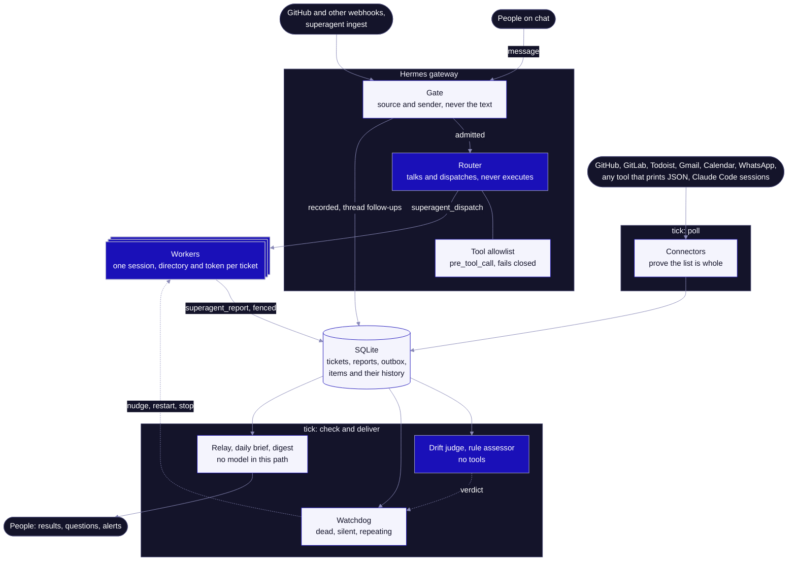

# Architecture

hermes-superagent is a Hermes plugin, a process on a timer and one SQLite file. Models do the talking and the work. Anything that has to hold even when a model is fooled, confused or just wrong is code around them.

Indigo boxes run a model, light boxes are code. No arrow goes from a model straight to a person: what workers report goes to the store, and code relays it, capped at 100 words.

## Who decides what

| Decision | Decided by | Why it's safe |
| --- | --- | --- |
| Can this event start work? | Gate, code | It reads the source and sender from your config. The text can't open it |
| Which tools can the router use? | `pre_tool_call` allowlist, code | Hermes fails closed if the hook errors |
| Is this report from the current worker? | Per-assignment token, code | A worker is fenced before it's stopped, so a late report is refused |
| Is this worker stuck? | Watchdog, code | A dead process, silence, identical reports or the same tool call repeating |
| Has this worker drifted off its goal? | Drift judge, model | It has no tools and can only answer `on_track` or `drifting`. The most a fooled judge can do is spend the repair budget |
| Does a team rule apply to this event? | Rule assessor, model | It has no tools, and a rule only records what it would have done until you set `act` |
| Is this item really closed? | The source, asked by id, code | Only a closed answer closes it. Anything else stays open |
| What should this task's brief say? | Brief writer, model | Code lints the result: every line cites a real piece, and commands or addresses only strangers wrote never reach a brief marked ready |

The full list of threats and what's left of each is in [DESIGN.md](../DESIGN.md#threat-model).

## What runs where

| Process | Started by | Job |
| --- | --- | --- |
| Hermes gateway | You, as your Hermes service | Runs the plugin's hooks and tools for the router and worker profiles. Workers are told apart by their session directory, because every profile shares this process |
| One worker per ticket | The router, through the `[worker] argv` you configure | Executes one task from its own directory and reports with `superagent_report`. `send_message` and cron are blocked |
| `superagent tick` | Your timer, every 2 minutes or so | One pass of everything below, then it exits. A lock keeps two from overlapping |
| Claude Code hook | Claude Code, on each session event | Appends a line to a local log that a read-only probe reads, over ssh for other machines. No Hermes needed |

Everything lives in one directory: `superagent.toml`, `superagent.db`, and `workers/<ticket>/<assignment>/` with each worker's brief, log and private identity file. With no role set in a profile the plugin's hooks do nothing and it offers no tools.

## One tick

Each phase runs even if the one before it failed. A failure is collected and tried again on the next tick, and one that lasts raises an alert.

| # | Phase | What it does |
| --- | --- | --- |
| 1 | Poll | Reads each connector that's due into the ledger, within half of the tick's deadline. A list it can't prove is whole marks nothing as gone |
| 2 | Triage | Files new items by your `[[triage]]` rules, or sets them aside with a reason |
| 3 | Relaunch | Sends one `continue` to a Claude Code session stopped by a rate limit or an API error, only with `relaunch = true` and after its pane, process and screen check out |
| 4 | Brief | Saves the daily brief once it's due |
| 5 | Assess | Runs waiting events past your team's written rules, under Hermes only |
| 6 | Watchdog | Checks every running worker and repairs within its budget: nudge, restart, escalate |
| 7 | Relay | Delivers reports, escalations and briefs in order from the outbox |
| 8 | Prune | Forgets ignored triggers after a week |
| 9 | Alerts | Raises and resolves alerts on lasting errors and source problems |
| 10 | Heartbeat | Runs your heartbeat command if the tick was clean, so an outside check can notice a dead timer |

## When something breaks

| What breaks | What happens |
| --- | --- |
| A worker crashes, hangs or loops | The next tick catches it and repairs within the budget, then a person is told |
| A worker can't be stopped | It's escalated as possibly still running |
| A source fails or returns a cut list | Nothing is marked gone, and the brief and the alerts channel say so |
| A snapshot shrinks by half or more | It's held back until you run `superagent ledger accept` |
| A message can't be delivered | It stays in the outbox and retries with backoff, in order |
| A tick runs past its deadline | It's stopped, and the next tick raises an alert |
| The timer dies | The heartbeat stops, for whatever outside check you point at it |
| `superagent.toml` gets broken | The tick keeps running on the last good config and says so |
| The drift judge fails | It never triggers a repair, and an alert says so |
| The gate itself fails | The message is dropped and logged, not let through |

## See it run

| Part | Where |
| --- | --- |
| Ledger, polling checks, daily brief | [`examples/nothing-slips`](../examples/nothing-slips) |
| Gate, router, workers, digest, thread pass-through, sessions board | [`examples/night-shift`](../examples/night-shift) |
| Watchdog checks, fencing, budgets | [`examples/watchdog`](../examples/watchdog) |
| The Hermes side, on real Hermes with a fake model | [`tests/e2e`](../tests/e2e), the `e2e` job in CI |

The README's [architecture section](../README.md#architecture) walks through one task, the watchdog's states and the ledger, and its [warning](../README.md#why) says what has and hasn't run with a live model.
